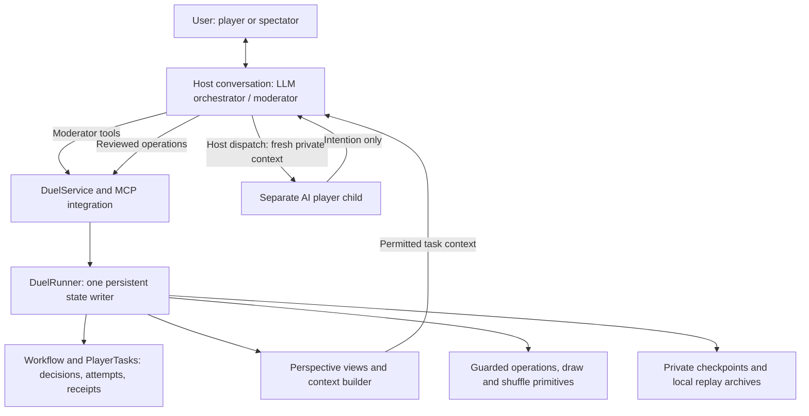
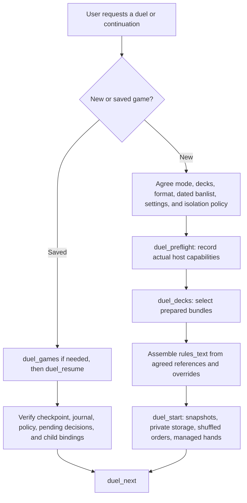
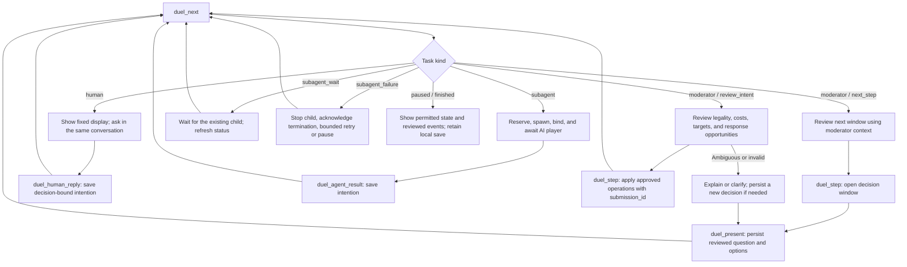
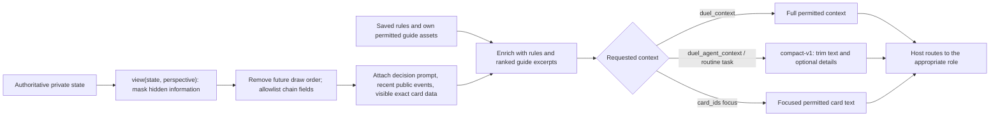
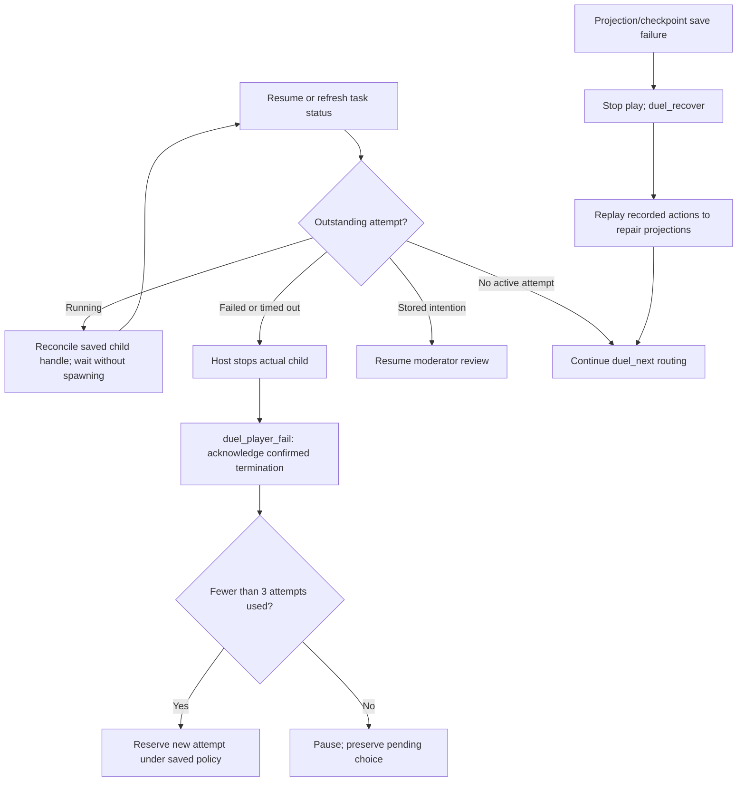

# Harness workflows, context flows, and agent prompts

The Yu-Gi-Oh! harness coordinates an LLM moderator, separate AI player agents,
and a persistent game runtime. The user talks to one orchestrator conversation.
The orchestrator acts as moderator and invokes the host's native subagent facility
for AI player choices. The Python runtime returns tasks; it does not spawn models
or call model APIs itself.

This page explains the existing workflow. Tool names describe internal calls made
by the orchestrator, not commands a duel player must run. See [orchestration](orchestration.md)
for the tool catalog and [harness internals](harness.md) for backend details.

## 1. Roles and responsibilities



| Component | Owns | Produces |
| --- | --- | --- |
| LLM orchestrator / moderator | Setup, rules interpretation, legal windows, coaching, effect and battle adjudication, public narration | Reviewed choices and approved bookkeeping operations |
| AI player child | Tactical choice for its assigned player from permitted information | A numbered choice or free-text intention |
| `Orchestrator.next()` | Selection of the next host task | Human display, player task, moderator context, wait/failure, or terminal state |
| `DuelRunner` and `Workflow` | Authoritative state, decision/input binding, structural validation, retry protection | Persisted transitions and execution receipts |
| Context builder | Perspective filtering, exact visible card data, bounded rules/guide excerpts | Full, compact, or focused permitted context |
| Storage | Checkpoints, immutable asset references, recorded actions and random outcomes | Resume and replay data |

The moderator and player are different agent instances, even if the host selects
the same model for both. The moderator has a continuing user conversation; routine
player dispatches use fresh children with no inherited moderator or sibling history.
The Python class named `Orchestrator` is a scheduler, not another LLM agent.

The runtime checks structural constraints and persistence. The LLM checks card
legality, timing, costs, targets, and restrictions against the agreed rules and
exact card text. A structurally accepted operation is not independent proof of
Yu-Gi-Oh! legality.

## 2. Setup and resume



Setup policies are loaded by the host moderator from
[the orchestrator policy](../agents/orchestrator/AGENT.md),
[shared moderator instructions](../agents/shared/moderator.md), the selected mode
policy, and [the orchestration skill](../skills/duel-orchestrator/SKILL.md).
The host supplies the underlying model instruction channels; the runtime does
not assemble these files into a vendor-specific moderator API request.

Rules, deck JSON, and guides are snapshotted for the game. Resume uses saved
assets and settings, preserves shuffled orders, and reconciles outstanding child
attempts before dispatching again. It does not initialize a replacement duel.

| Mode | Human information held by the runtime | Who chooses? |
| --- | --- | --- |
| `managed` | Selected human deck and known hidden cards | Human in the main conversation; AI opponent in a child |
| `self` | Counts and legally revealed information; human hidden identities remain unknown | Human managing their own cards; AI opponent in a child |
| `agent-vs-agent` | Both decks and managed hidden states | A separate child for each active AI player, sequentially |

In agent-versus-agent mode, the internal slot names `human` and `agent` mean
Agent 1 and Agent 2. The user is a spectator. Legacy `open`/`blind` saves retain
their original semantics; they are not interchangeable with the modes above.

## 3. The decision loop

`duel_next` routes the workflow. It neither decides a move nor executes a returned
player answer.



The moderator reviews compulsory steps too. Only a complete no-choice review can
justify automatic progression. Unknown human responses in self mode are not
proof that no response exists. A chain or turn may require several decisions;
the loop is not one player call per turn and does not execute an entire combo
without intervening response windows.

## 4. An AI choice from dispatch to execution

```mermaid
sequenceDiagram
    participant M as Host LLM moderator
    participant H as Harness runtime
    participant C as Fresh player child
    M->>H: duel_next
    H-->>M: subagent task + permitted compact context
    M->>H: duel_player_start(task_id, request_id, isolation)
    H-->>M: attempt_id, deadline, dispatch_authorized
    alt Dispatch authorized
        M->>C: Spawn with policy, task identity, context; no inherited history
        M->>H: duel_player_bind(task_id, attempt_id, child_id)
        C-->>M: Numbered choice or free-text intention
        M->>H: duel_agent_result(task_id, attempt_id, response)
        H-->>M: Stored submission
        M->>H: duel_next
        H-->>M: moderator / review_intent + moderator context
        Note over M: Check exact text, timing, costs, targets, restrictions, and responses
        M->>H: duel_step(request_id, reviewed request, submission_id)
        H->>H: Validate structure; record action; update checkpoint and receipt
        H-->>M: Revision, public summary, permitted state
    else Duplicate reservation
        Note over M,H: Reuse saved attempt; do not spawn another child
    end
```

Player tasks are correlated by `task_id` and `decision_id`; a dispatch attempt adds
`attempt_id`, a deadline, and the native child handle. Applied operations also
carry stable execution request IDs and the submitted intention's ID. These
bindings prevent stale answers, duplicate dispatches, and repeated effects.

The player cannot approve its own action. Its answer becomes data in a submission;
the moderator supplies the execution plan. Instructions never authorize giving a
child moderator credentials, private checkpoints, or raw replay archives.

## 5. How a context is built



Filtering happens before compaction. Full context means a fuller **permitted
view**, not the authoritative save or an omniscient archive. Neither full nor
compact LLM context exposes future draw order. The moderator may receive an
unordered remaining-Deck inventory; compact mode removes that inventory.

| Context field | Meaning |
| --- | --- |
| `perspective` | `human`, `agent`, `moderator`, or `public` |
| `state` | Filtered board, LP/counts, turn/phase, chain, pending effects, usage, restrictions, and revision |
| `decision` | Current actor and decision window |
| `prompt` | Saved decision ID, question, event narration, hand-reference mapping, and recommendation labels/reasons; included for the active actor or moderator |
| `recent_events` | Public action summaries, not full private action records |
| `cards` | Exact selected gameplay fields for permitted visible card identities |
| `rules` | Saved rules excerpt, format/banlist/version, and settings |
| `guides` | Ranked excerpts from the perspective's permitted deck guides |
| `context_version`, `context_limits` | Compact format label and descriptions of omitted/bounded information |
| `submitted_intentions` | Current submitted intentions for moderator review only |

### Visibility by recipient

| Information | Moderator | Assigned player child | Public spectator |
| --- | --- | --- | --- |
| Public state and reviewed events | Yes | Yes | Yes |
| Player's own known hand and set cards | Yes for managed cards | Yes | Hidden in agent-versus-agent |
| Opponent's hidden cards | Yes for managed cards | No in standard private play | No in agent-versus-agent |
| Own Extra/Side identities | Yes for managed cards | Yes; compact Side omitted outside sideboarding | Counts |
| Private deck guidance | Managed-player guides | Own guide only | None |
| Moderator/sibling conversation history | Host moderator conversation | Never inherited in routine dispatch | No |
| Future draw order | Excluded from LLM context | Excluded | Excluded |
| Raw checkpoint or replay archive | Trusted backend storage | Never supplied | Never supplied |

Self-mode human hidden identities are unknown even to the moderator. Legacy open
visibility and an explicitly configured non-agent-versus-agent hand display can
change visibility; use the saved mode/presentation settings rather than assuming
all games have the same policy.

### Compact mode and focused requests

Routine moderator and player tasks use `compact-v1`:

- Keep the four most recent events instead of ten.
- Rank guide sections by relevant card names and the current phase/window, with a
  default budget of 1,200 characters per deck instead of 5,000.
- Include exact card text selected from hands, board zones, graveyards, banished
  cards, chains, and pending effects in the permitted view.
- Keep Extra/Side entries as identities and selected basic stats; omit Side Deck
  entries outside sideboarding and unused Extra/Side effect text.
- Remove the moderator's Deck inventory and prune old attack-usage entries.

Rules remain bounded to the first 8,000 characters, with a `truncated` flag;
compact mode does not apply a smaller rules budget. Full context is also bounded
for rules and guide excerpts. An omitted card text or truncated excerpt does not
prove an action is unavailable.

The moderator can request `duel_agent_context(player, card_ids)` for focused exact
text, including permitted Extra/Side identities, or `duel_context` for fuller
details before dispatch or clarification. A card focus selects the `cards` map;
it does not reduce the whole state to those cards. Default native player children
are instructed not to call tools, so the host moderator obtains missing details
and supplies the refreshed permitted context.

## 6. What prompts reach each agent?

### Moderator instructions and runtime tasks

The moderator reads the repository policies and selected rules during setup,
then receives runtime task envelopes. These are inputs to the host conversation,
not a separate runtime-created moderator model request.

The following is a schematic envelope; placeholders are not a complete executable
context:

```json
{
  "kind": "moderator",
  "stage": "review_intent",
  "intention": "<saved decision-bound submission>",
  "context": "<compact moderator perspective at the current revision>"
}
```

At `next_step`, the moderator determines the next legal window and prepares its
question/options. At `review_intent`, it checks the stored choice and prepares
approved operations. Rules interpretation stays with the moderator; strategy
selection stays with the assigned player.

### Native player task

`Orchestrator.next()` supplies this shape to the host, which adds the reserved
attempt identity when dispatching. The host forwards only the permitted task
content, with no parent/sibling history or private file paths:

```json
{
  "kind": "subagent",
  "task_id": "<durable task ID>",
  "decision_id": "<persisted decision ID>",
  "revision": 12,
  "player": "agent",
  "instructions": "<PLAYER_POLICY>",
  "isolation_policy": "cooperative",
  "context": "<compact permitted player context>"
}
```

The runtime's actual shared `PLAYER_POLICY` is:

> You are a Yu-Gi-Oh! player, not the moderator. Choose one intention using only
> the supplied context and card text. Return response as a number or free text.
> Do not mutate state, inspect files, call moderator tools or any other tools, or
> use parent/sibling conversation history. Do not use network, filesystem,
> execution, or delegation capabilities even if the host makes them available.
> Return only your intention.

A reply can be `1`, selecting the first saved recommendation, or a concise
free-text declaration with necessary targets/costs. The response is an intention,
not executable code, a state patch, or a certified legal move. Numbered answers
are resolved against the persisted menu; H/A hand references stay bound to
physical-copy IDs from that prompt.

### Optional tool-free model request

For a trusted context-only transport,
[`model_request`](../harness/players/isolated.py) constructs an explicit request:

```json
{
  "messages": [
    {"role": "system", "content": "<PLAYER_POLICY>"},
    {"role": "user", "content": "<serialized permitted player context>"}
  ],
  "tools": [],
  "tool_choice": "none"
}
```

The transport must not append history, tools, or filesystem contents. This helper
is optional; routine host-native dispatch is not automatically this API request.
The [role-bound arena](agent-vs-agent.md#optional-deployment-backend) is another
optional deployment path with restricted player context/submission/status tools;
its role-bound clients differ from the default no-tools native children.

## 7. Isolation, failure, and recovery

Cooperative isolation uses fresh context and instructions forbidding tools/files;
the host may still expose those capabilities. Enforced isolation requires a
verified host boundary or a tool-free transport. A filtered context is an
information boundary, not a filesystem sandbox. Host declarations record
capabilities and evidence, not independent sandbox attestation.



Timeouts are detected on runtime calls; they do not kill host children. A retry
waits for confirmed termination, and the budget is three attempts per decision
boundary. Late/cancelled answers are rejected. The moderator must not invent a
fallback player choice.

Actions are journaled before derived projections/checkpoints. Recovery reconstructs
already recorded outcomes without repeating an effect or resampling randomness.
Stable IDs with identical payloads return receipts; reusing an ID for different
content is rejected. Exact pending menus, known hidden state, attempts, child
handles, submissions, and receipts survive checkpoint restore.

Private checkpoints support continuation; replay archives preserve known hidden
information for review. Neither is a player prompt. Archives and shared snapshots
stay local and ignored by Git. See [game storage](game-storage.md) and
[player isolation](player-isolation.md) for their complete contracts.

## 8. Implementation map

| Workflow or context step | Source |
| --- | --- |
| Lobby setup/resume and persistent service | [service.py](../harness/integration/service.py) |
| Moderator tools and compact-context flag | [mcp.py](../harness/integration/mcp.py) |
| Task routing and player instruction text | [orchestrator.py](../harness/runner/orchestrator.py) |
| Attempt reservation, binding, deadline, and result | [player_tasks.py](../harness/runner/player_tasks.py) |
| Decision menus, input binding, and execution receipts | [workflow.py](../harness/runner/workflow.py) |
| State ownership and context assembly | [duel.py](../harness/runner/duel.py) |
| Hidden-information filtering | [perspective.py](../harness/views/perspective.py) |
| Rules and guide enrichment | [context.py](../harness/runner/context.py) |
| Compact context selection | [agent_context.py](../harness/runner/agent_context.py) |
| Optional stateless tool-free request | [isolated.py](../harness/players/isolated.py) |
| Human/spectator display | [decision.py](../harness/rendering/decision.py) |
